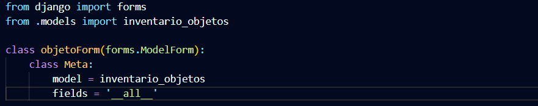

# **Cambios realizados 20/10/2026**

## **APP DE INVENTARIO**
### **HTML**
> - **index.html** ya siendo la base del navbar y lo que tendrán las otras páginas
> - **inventario.html** ya mostrando las tablas de los objetos disponibles, permitiendo ver en detalle los objetos y buscarlos (ya sea por código, descripción, marca, modelo, serie, observaciones) 
> - **agregar_objeto.html** funcionando al 100%. Agrega objetos a la base de datos sin problemas
> - **detalles_objeto.html** funcionando al 100%. Muestra datos del objeto, permite regresar al inventario, permite actualizar el objeto y permite borrar el registro/objeto.
> - **exportar.html** todavía está sujeto a cambios

*Enlace de los html*: [templates](proyecto\inventario\templates)

#

### **Base de datos**
Alberga los siguientes elementos, pero está sujeto a cambios en los campos de datos.

*Elementos que alberga:*
> - Código del objeto
> - Descripción del objeto
> - Marca del objeto
> - Módelo del objeto
> - Serie del Objeto
> - Fecha de adquisición del objeto
> - Valor unitario del objeto
> - Observaciones

*Enlace de modelos/campos de la base:* [models.py](proyecto\inventario\models.py)

#

### **Views**

Estas son las view que necesita la página para tener lógica.

*Imagen descriptiva de una view:*

- *model:* Nuestra base de datos
- *template_name:* el nombre relativo que le dimos a nuestra página en urls.py
- *context_object_name:* Nombre de la app (en este caso "inventario")

*Enlace de views.py:* [VIEWS](proyecto/inventario/views.py)

*Enlace de urls.py* [URLS](proyecto/inventario/urls.py)

#

### **Forms**

Unicamente es para permitir que haya formularios en las páginas html e ingresar objetos en la base de datos. Ya que toma todos los campos antes establecidos en la parte del models.py y esos campos los pone en html.

*Imagen de código:*

#

## **Nuevas cosas añadidas al entorno virtual**
- Reportlab para exportar a pdf
- Python-docx para exportar a word
- Openpyxl para exportar a excel

- Operativo el PDF (pero sujeto a cambios)
- Operativo el WORD (pero sujeto a cambios)
- Operativo el EXCEL (pero sujeto a cambios)